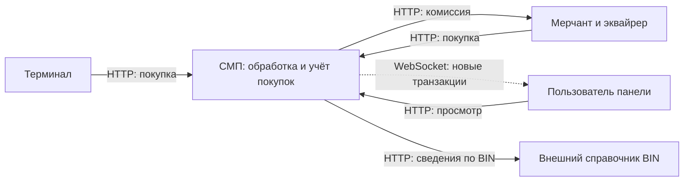

# А1. Контекст СМП

**Не хватало:** отдельной схемы границ системы и протоколов внешних участников.
**Добавлено:** терминал, мерчант, пользователь панели и внешний справочник BIN. Симуляторы и справочник входят в учебный стенд, но играют роли внешних систем относительно ядра процессинга.

Запросы покупок входят через Gateway. Внешний BIN Lookup обогащает данные, маршрут определяется таблицей Switch.
