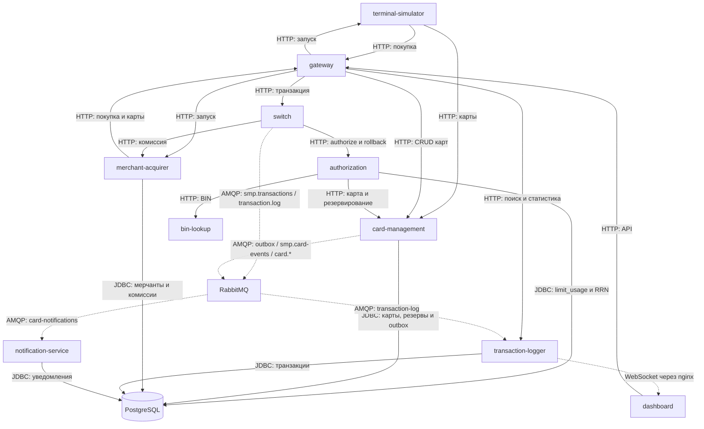

# А2. Сервисы и связи

**Не хватало:** разделения синхронных вызовов и очередей, пути outbox и сверки с Compose.
**Добавлено:** все 10 прикладных сервисов из Compose, PostgreSQL и RabbitMQ. `common` является библиотекой. Мониторинг включается отдельным профилем.

Сплошные стрелки показывают синхронные HTTP/JDBC-вызовы. Пунктир показывает AMQP и WebSocket, где ответ пользователю не означает завершения доставки.

Публикация в очередь отделена от сохранения потребителем в БД. Подтверждение брокера не означает завершение обработки сообщения.
