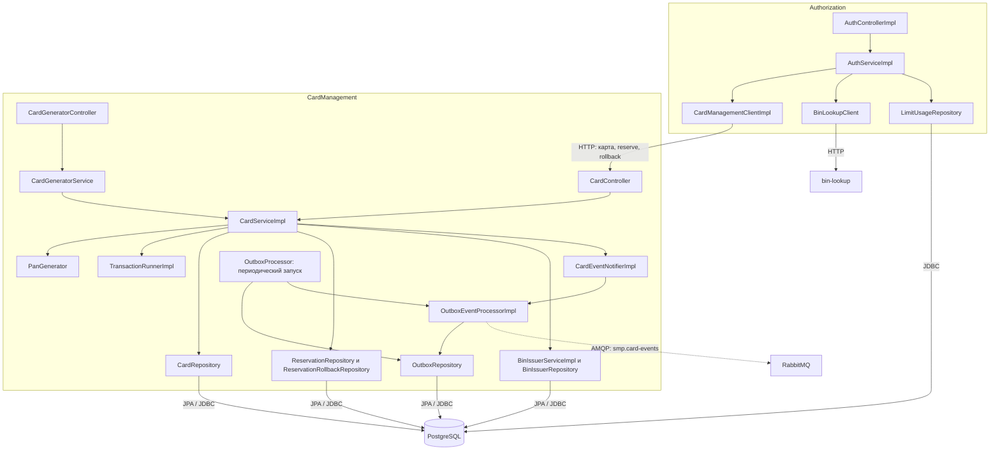

# А3. Компоненты ядра

**Не хватало:** внутренних связей авторизации и управления картами.
**Добавлено:** контроллеры, бизнес-логика, HTTP-клиенты, репозитории и обработка outbox. Сплошные стрелки являются вызовами внутри процесса или синхронными HTTP/JDBC-связями. AMQP выделен пунктиром.

Репозитории на схеме являются интерфейсами, адаптеры связывают их с JPA.

Изолированная логика и моки клиентов подходят для юнит-тестов. SQL, транзакционное сохранение outbox и доставка RabbitMQ требуют интеграционных проверок. Обработчик запускается раз в 1000 мс по умолчанию, после трёх ошибок событие получает `FAILED`.
