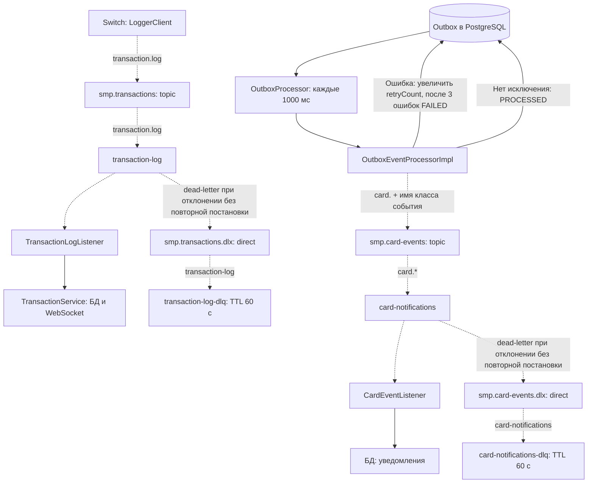

# А5. RabbitMQ

**Не хватало:** наглядной топологии двух потоков, DLX/DLQ и отделения повторов outbox от повторной доставки потребителю.
**Добавлено:** имена exchange, очередей, ключей и потребителей. Пунктир показывает передачу сообщений по AMQP. Вызов отправки из outbox и сохранение его состояния выполняются внутри сервиса.

- Для publisher confirm включён режим `correlated`.
- У основных очередей задан `x-max-delivery=3`. Повторы обработки и переход в DLQ проверяются в N-12.
- После трёх ошибок отправки событие outbox получает `FAILED`. Это отдельный механизм от повторов обработки в Logger и Notification.
- TTL у DLQ составляет 60 секунд.
