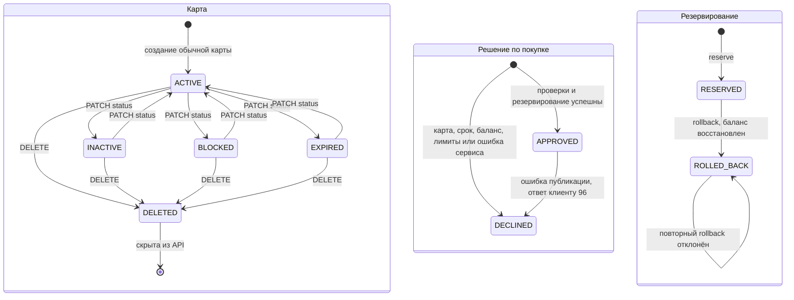

# А6. Состояния карты и операции

**Не хватало:** диаграммы состояний и различия между решением по покупке и резервированием.
**Добавлено:** статусы карты, результат авторизации и откат резерва. Переходы здесь являются действиями бизнес-логики, а не сетевыми связями.

Показаны основные переходы карты. `patchCard` не задаёт отдельной матрицы разрешённых переходов между неудалёнными статусами, поэтому допускает и прямые переходы вроде `BLOCKED` в `INACTIVE`. Генератор может сразу создать `INACTIVE` или `BLOCKED`.

Прошедший срок вызывает отказ `54`, но автоматически не меняет сохранённый `Card.status`. Статус `EXPIRED` на схеме устанавливается явно. В enum транзакции есть только `APPROVED` и `DECLINED`. `ROLLED_BACK` является состоянием резерва. Стрелка решения `APPROVED` в `DECLINED` описывает изменение ответа клиенту, а не обновление записи Logger.
